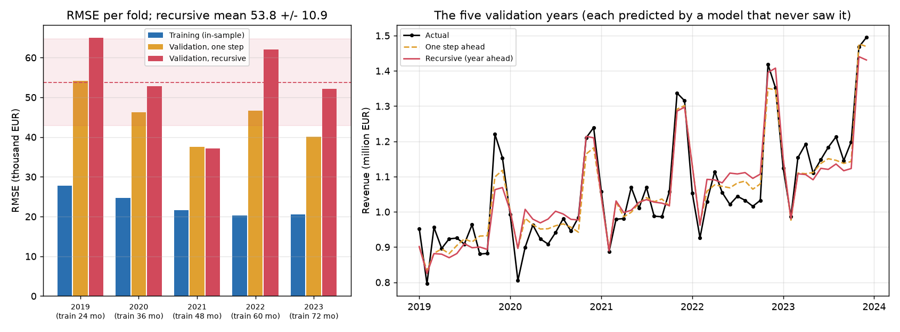
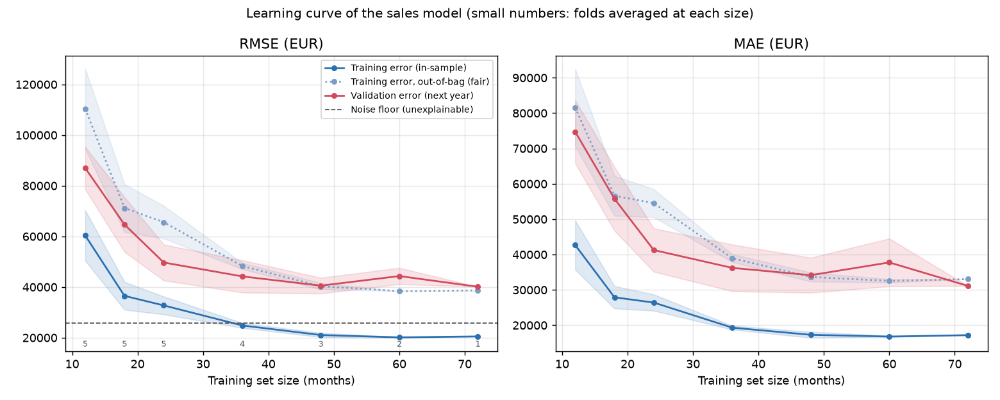

# Technical evaluation of the sales forecast model

Model: Random Forest on causal lag / rolling / calendar features, predicting `revenue_eur` of the `consolidated` row of `data/raw/trackflow_sales.csv`
(TrackFlow, monthly, 2016-01 .. 2025-12). Evaluated on the **training years only** (2016-2023): the two test years were not used to diagnose or to choose anything.
Regenerate this report and its figures with `python scripts/evaluate_sales_forecast.py`. Errors are given in EUR and as a % of mean monthly revenue.

## 1. Answers to the ticket

1. **Underfitting, overfitting or well fitted?** **Overfitting (mild, high variance). It is not underfitting.**
   The training error (2.52% of monthly revenue) is at the noise floor (2.58%, the part of the month-to-month variation that no model can explain), so there is no bias problem: the model captures the trend and the seasonality and is not underfitting. But the validation error is 4.31% (1.7x the floor), a gap of 1.8 points that persists at every training size (47% of the validation error at the largest size). That is the learning-curve signature of overfitting. It is mild: the validation error is still small in business terms, and the out-of-bag error (4.89%), the fair estimate of the training error of a forest, is close to the validation error, so the model generalises consistently.
2. **How stable is it when the training data changes?** Moderately stable. Across 5 expanding folds the validation RMSE is **5.14 ± 1.27%** of monthly revenue (year ahead, recursive) and **4.31 ± 0.94%** (one step ahead): a spread of about ±25% of the error itself. Two things move it: the size of the training window (the first fold, with 24 months, is the worst) and the growth of the year being predicted (section 5).
3. **Corrective action.** Add a **growth-regime feature** (`yoy_growth_prev`: growth of the last 12 months over the 12 before) and **do not regularise harder**. Evidence in section 6: it addresses the systematic part of the error, while the tested regularisation makes the validation error worse (from 4.31% to 5.23% with `min_samples_leaf=4`). Effect measured on these same folds: year-ahead RMSE 5.14% to 4.55% (11% lower).

## 2. Time-aware cross-validation

`TimeSeriesSplit(n_splits=5, test_size=12)` over the 84 feature rows of the training years (2017-01 .. 2023-12; the first year is only history for the lags). Expanding windows: each fold trains on the past and validates on the next full year, so every validation block holds a February and a Black Friday peak. A new model (scaler included) is fitted inside each fold.

| Fold | Training window (months) | Validation year | Train RMSE | Valid. RMSE, one step | Valid. RMSE, recursive | Bias, one step | Newest month a training row reads < first validation month |
|---|---|---|---|---|---|---|---|
| 1 | 2017-01 .. 2018-12 (24) | 2019-01 .. 2019-12 | 3.22% | 5.67% | 6.80% | -2.1% | 2018-12 < 2019-01 |
| 2 | 2017-01 .. 2019-12 (36) | 2020-01 .. 2020-12 | 2.76% | 4.71% | 5.37% | +1.1% | 2019-12 < 2020-01 |
| 3 | 2017-01 .. 2020-12 (48) | 2021-01 .. 2021-12 | 2.35% | 3.54% | 3.50% | -0.4% | 2020-12 < 2021-01 |
| 4 | 2017-01 .. 2021-12 (60) | 2022-01 .. 2022-12 | 2.14% | 4.27% | 5.68% | +2.2% | 2021-12 < 2022-01 |
| 5 | 2017-01 .. 2022-12 (72) | 2023-01 .. 2023-12 | 2.11% | 3.34% | 4.34% | -2.1% | 2022-12 < 2023-01 |

(RMSE as % of the mean monthly revenue of the block; bias > 0 means the model over-forecasts.)

- **No shuffling, order preserved:** `verify_folds` checks for every fold that the training rows and the validation rows are consecutive and ascending, that every training row is before every validation row, that the sets do not overlap, and that the validation windows follow each other in time. A unit test (`tests/pipelines/test_sales_evaluation.py`) runs the same check and shows that it fails on a shuffled split.
- **No leakage across the fold boundary:** the lag / rolling features of row *t* read only months before *t*, so a training row never reads the validation year. It is verified, not assumed (`check_fold_leakage`): for each fold the features are recomputed from the series **cut** at the fold boundary and must be identical to those computed on the full series (they are, in all 5 folds), and the newest month any training row reads is the month before the validation window (last column). The scaler and the forest are fitted on the fold's training rows only; a unit test changes the validation year (x5) and checks that the fitted model does not change.
- **Reported as mean ± standard deviation across folds** (table below), not as one aggregate number.

| Error (5 folds, mean ± std) | RMSE (EUR) | RMSE, % of mean revenue | MAE (EUR) | MAE, % of mean revenue |
|---|---|---|---|---|
| Training, in-sample | 22,954 ± 3,238 | 2.52 ± 0.47% | 18,884 ± 2,783 | 2.07 ± 0.40% |
| Training, out-of-bag | 44,527 ± 8,298 | 4.89 ± 1.13% | 37,589 ± 7,292 | 4.13 ± 0.99% |
| **Validation, recursive (year ahead)** | **53,790 ± 10,873** | **5.14 ± 1.27%** | 45,393 ± 9,477 | 4.32 ± 0.97% |
| Validation, one step ahead | 44,938 ± 6,439 | 4.31 ± 0.94% | 37,654 ± 6,390 | 3.61 ± 0.85% |

## 3. Learning curve

Training error and validation error as the training set grows (a model per size and per fold, fitted on the most recent *n* months before the validation year; validation one step ahead). Figure: `data/eval/learning_curve.png`; the shaded bands are ±1 std across folds. The values (the largest sizes only exist in the later folds):

| Training months | Folds averaged | Train RMSE | Train RMSE, out-of-bag | Validation RMSE | Train RMSE (EUR) | Validation RMSE (EUR) |
|---|---|---|---|---|---|---|
| 12 | 5 | 6.06% | 11.08% | 8.25% | 60,336 | 86,971 |
| 18 | 5 | 3.66% | 7.14% | 6.17% | 36,513 | 64,671 |
| 24 | 5 | 3.38% | 6.78% | 4.72% | 32,733 | 49,680 |
| 36 | 4 | 2.57% | 5.00% | 4.09% | 24,825 | 44,197 |
| 48 | 3 | 2.18% | 4.16% | 3.63% | 21,043 | 40,542 |
| 60 | 2 | 2.08% | 3.96% | 3.89% | 20,122 | 44,328 |
| 72 | 1 | 2.11% | 3.99% | 3.34% | 20,497 | 40,106 |

**Reading it.**
- **Not underfitting.** Underfitting would show both curves converging at a high error. Here the training error is already 3.7% with 18 months and settles at about 2.1%, the noise floor (2.6%): the model fits the pattern. A more complex model could only fit the noise further, so "increase complexity" would be the wrong response.
- **A wide, persistent gap.** The validation error starts at 8.3% with 12 months and falls to 3.9% with 60, but it does not meet the training curve: the gap is still 1.8 points (47% of the validation error) at the largest size. Training below the noise floor means the forest is learning the noise of single months.
- **How big a problem it is.** The in-sample number is optimistic by construction for a forest (every tree has seen most of the rows it is scored on). The out-of-bag training error is the fair one, and it sits right next to the validation error: the model does not collapse on new years, it is consistently about 1.7x the noise floor. That is why the verdict is *mild* overfitting, not a model to reject.
- **The curve is still falling,** so more years will keep helping a little. That is not the corrective action: history cannot be bought, and section 6 shows a cause that more data does not remove.

## 4. Metric choice: RMSE or MAE?

Both are computed for training and validation (tables above). **Primary metric: RMSE.**

- The context says the revenue follows the shipment volume of e-commerce brands, with sharp peaks (November-December, +25-35%) that Ana (Warehouse) and Carlos (Carriers) staff and book for by hand every year. A miss in a peak month is not "a bit more of the same" error: it is a warehouse short of people or a missed carrier booking, and its cost grows faster than its size. RMSE squares the error, so one big miss in a peak weighs more than several small misses in quiet months, which is how the business pays for them. MAE treats a 100,000 EUR miss as exactly twice a 50,000 EUR miss, which understates that.
- The data agrees: the validation error in November-December is **53,679 EUR RMSE** against **43,437 EUR** in the other months. The five largest misses of the validation set are: 2019-11 (-120,729 EUR), 2020-02 (+90,293 EUR), 2023-04 (-84,175 EUR), 2020-03 (+82,537 EUR), 2022-01 (+78,189 EUR).
- MAE stays as the second number because it is the easy one to say to Finance: *a typical month is off by 37,654 EUR (3.6%)*. RMSE / MAE is 1.19; for evenly spread errors it is about 1.25, and a higher value means errors concentrated in a few months, which is what to watch.

## 5. Stability: what moves the error between folds

- **Training window size.** Fold 1 trains on 24 months and has the highest error; the errors of folds 3-5 (48-72 months) are lower. Learning curve and folds say the same thing.
- **The growth of the year being predicted.** The signed bias of the one-step validation follows the alternating growth of the context (about 9% and 3%): 2019: -2.1% (growth 9.4%), 2020: +1.1% (growth 2.9%), 2021: -0.4% (growth 8.0%), 2022: +2.2% (growth 2.8%), 2023: -2.1% (growth 10.1%). The model over-forecasts the low-growth years and under-forecasts the high-growth ones. This is a *systematic* error, not noise: the trailing 12-month mean that the model predicts relative to lags the growth of the current year, and nothing in the features says which kind of year is coming. It is the largest identifiable part of the gap above the noise floor.

## 6. Corrective action

**Diagnosis: mild overfitting, plus a systematic error tied to the yearly growth regime.** The candidate corrective actions were cross-validated on the same five time-aware folds (training years only, test years untouched):

| Setting | Train RMSE | Validation RMSE, one step (mean ± std) | Validation RMSE, recursive (mean ± std) |
|---|---|---|---|
| current (min_samples_leaf=2, max_features=0.7) | 2.52% | 4.31 ± 0.94% | 5.14 ± 1.27% |
| min_samples_leaf=4 | 4.20% | 5.23 ± 1.79% | 5.76 ± 1.69% |
| min_samples_leaf=6 | 5.61% | 6.41 ± 2.31% | 6.54 ± 1.91% |
| min_samples_leaf=8 | 6.73% | 7.36 ± 2.37% | 7.37 ± 1.86% |
| min_samples_leaf=4, max_features=0.5 | 4.48% | 5.57 ± 1.85% | 6.01 ± 1.67% |
| min_samples_leaf=6, max_features=0.5 | 5.95% | 6.76 ± 2.22% | 6.89 ± 1.78% |
| max_depth=4 | 3.06% | 4.37 ± 0.90% | 5.12 ± 1.15% |
| seasonal index added (lag_12_rel kept) | 2.35% | 4.16 ± 0.89% | 5.05 ± 1.29% |
| seasonal index replaces lag_12_rel | 2.73% | 4.47 ± 0.92% | 5.22 ± 1.26% |
| growth-regime feature added (yoy_growth_prev) | 2.36% | 4.22 ± 1.00% | 4.55 ± 1.33% |
| growth-regime feature + seasonal index (replaces lag_12_rel) | 2.57% | 4.34 ± 0.96% | 4.67 ± 1.34% |

1. **The textbook cure does not work here: do not regularise harder.** Larger leaves and shallower trees close the train/validation gap only by making the *training* error worse: `min_samples_leaf=4` moves the validation RMSE from 4.31% to 5.23%, the worst setting tested reaches 7.36%, and `max_depth=4` leaves it unchanged (4.37%). With 24-72 rows a forest cannot afford larger leaves: it starts missing the seasonal shape (bias) before it removes any noise (variance). The gap exists, but the leaf size is not what limits generalisation.
2. **The action: add `yoy_growth_prev` to the features** (growth of the last 12 months over the 12 before; causal, already implemented in `features.py`; while there is no previous year to compare, the base growth of the context, 6%, is used). It tells the model whether the year that just ended was a high- or low-growth year, which the alternating 9% / 3% growth makes informative. On the same folds it lowers the year-ahead (recursive) validation RMSE from 5.14% to **4.55%** (11% lower) and the one-step one from 4.31% to 4.22% (2% lower). The year-ahead forecast is where the growth regime matters most, because there the model cannot see this year's real growth. The size of the effect, honestly: the gain is 0.5 fold standard deviations of the recursive error, so it is evidence in the right direction, not a proof. It should be adopted, confirmed once on the test years (they have not been used here) and re-checked as new years arrive.
3. **Tried and not worth a change:** averaging the same-month ratio over all earlier years (`seasonal_index_rel`) changes the validation error by less than the fold-to-fold noise, alone or together with the growth feature. The noise in a single last-year observation is real, but it is not what dominates the error.
4. **What would be the wrong response:** more complexity (the model is already at the noise floor on training data); more regularisation (tested, worse); "more data" as the first move (the learning curve says it helps slowly and it cannot be had quickly: each extra year takes a year).

## 7. Limits of this evaluation

- Five validation years is a small sample: one fold of 12 months weighs 20% of the mean, and the ± values are themselves uncertain.
- The noise floor (2.58%) is estimated from the decomposition residual of the training years; it is a guide, not a measured limit.
- The diagnosis rules are written in `evaluation.diagnose` (training error at or below ~1.1x the floor and a gap of at least 25% of the validation error at every size = overfitting; training error above ~1.3x the floor with a small gap = underfitting), so another reader can check the verdict against the numbers instead of trusting a sentence.
- The model of the forecast was not changed by this evaluation; the candidate settings are experiments.
