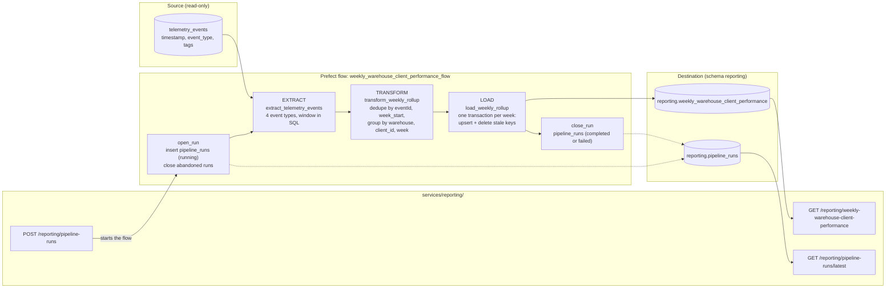

# Weekly Warehouse & Client Performance Pipeline: design

Status: **design only** (Milestone 6, part 1). No orchestration code yet. Part 2 implements it, part 3 splits it into subflows and adds tests.

This document designs one new data pipeline for TrackFlow. It turns the telemetry the backoffice already stores into the weekly rollup that Thomas (CEO) and Ana (Head of Warehouse Operations) read on Monday morning, so their directors no longer assemble it by hand on Sunday night.

## At a glance

| | |
|---|---|
| Business deliverable | The **Weekly Warehouse & Client Performance Report**: throughput, stockout activity and inventory accuracy per warehouse and per client, per week |
| Audience and cadence | Thomas (CEO) and Ana: weekly, fresh by Monday morning |
| KPIs | Inbound Volume, Outbound Throughput, Stockout Frequency, Discrepancy Rate |
| Source (read-only) | `telemetry_events`, four event types |
| Destination | `reporting.weekly_warehouse_client_performance` (plus the run log `reporting.pipeline_runs`) |
| Grain | one row per `warehouse` x `client_id` x ISO week (`week_start` = the Monday, UTC) |
| Orchestration | one Prefect flow, `weekly_warehouse_client_performance_flow`, with five tasks |
| Exposed by | `services/reporting/` (three endpoints), which only call functions in `data/pipelines/` |
| Left untouched | `services/telemetry/analysis.py`, `GET /telemetry/report`, the `telemetry_events` table |

The three properties this design is built around, and where each is shown:

- **Idempotency**: running twice on the same data gives the same table, with no duplicates and no change to rows that did not change (section 3.1).
- **Observability**: every run leaves a row in `reporting.pipeline_runs` with what it read, wrote, skipped and why it failed (sections 3.3 and 3.4).
- **Recoverability**: a failed run needs no manual repair: the next run recomputes the same weeks from an immutable source (section 3.2).

---

## 1. Current state

### 1.1 What is captured

The backoffice (`uis/backoffice`) records usage events through one function, `track(eventType, properties)` in `lib/telemetry.ts`. Events are queued in the browser and sent in batches (every 10 seconds or at 20 events, with `sendBeacon` when the tab is hidden) to `POST /telemetry/events`. The approved plan (`docs/telemetry/telemetry-plan.md`, schema 1.2.0) defines 38 events; 26 are instrumented in the browser today, including the four mandatory metrics this pipeline needs:

| Event | When it fires | Properties this pipeline uses |
|---|---|---|
| `inbound_order_created` | a goods receipt is saved (`inventoryApi.createInboundOrder`) | `warehouse`, `client_id`, `quantity` |
| `outbound_order_created` | a dispatch or a confirmed loss is saved (`inventoryApi.createOutboundOrder`) | `warehouse`, `client_id`, `exit_type`, `quantity` |
| `stock_threshold_triggered` | an outbound order takes a SKU from at or above its minimum to below it, or to zero (edge-triggered) | `warehouse`, `client_id`, `severity` |
| `inventory_discrepancy_detected` | a stock count differs from the system stock and is settled with an adjustment order | `warehouse`, `client_id`, `quantity`, `direction` |

Stock-count adjustment orders are deliberately **not** reported as `inbound_order_created` or `outbound_order_created`, so reconciliation never inflates volume.

### 1.2 Where it is stored

Events land in `telemetry_events` (PostgreSQL on Supabase), written by `services/telemetry_store.py` after each event is validated against the plan:

| Column | Type | Content |
|---|---|---|
| `id` | `uuid` | generated |
| `timestamp` | `timestamptz` | the moment of capture in the browser (UTC) |
| `service` | `text` | `backoffice` |
| `event_type` | `text` | e.g. `inbound_order_created` |
| `level` | `text` | `info`, `warn` or `error` |
| `value` | `numeric` | a copy of the event's main number (`quantity` for the four events above) |
| `message` | `text` | static description |
| `tags` | `jsonb` | the event's allowlisted properties plus `_envelope` (`eventId`, `sessionId`, `userId`, `schemaVersion`, `requestId`) |

The table is append-only (a trigger refuses `UPDATE` and `DELETE`) and has three indexes: `timestamp`, `event_type` and a GIN index on `tags`. This pipeline's queries use the first two.

Example row (an outbound dispatch at the Los Angeles warehouse):

```json
{
  "timestamp": "2026-11-22T05:09:05.319Z", "service": "backoffice", "event_type": "outbound_order_created",
  "level": "info", "value": 15,
  "tags": {
    "warehouse": "los_angeles", "country": "US", "client_id": "purestep-footwear", "product_id": "CLT-SNK-W-42",
    "product_category": "fashion", "order_id": "4", "exit_type": "dispatch", "quantity": 15, "stock_after": 5,
    "_envelope": { "eventId": "62102e9d-63ee-4d07-8390-f262ae145a8a", "schemaVersion": "1.2.0", "...": "..." }
  }
}
```

### 1.3 What the technical report already answers

`services/telemetry/analysis.py` and `GET /telemetry/report` serve engineering with seven operational metrics, cached for 60 seconds: events per day, error rate by day and by type, page-load latency, network failures by route, frontend errors by route, and sign-in failure rate. They answer "is the system healthy?" for engineers.

### 1.4 The gap

| Question the business asks | What the technical report gives | Why it is not enough |
|---|---|---|
| How many units did each warehouse receive for each client this week? | event counts per day and event type | no `warehouse` or `client_id` dimension; counts events, not units; day grain, not week |
| How many orders did each warehouse dispatch for each client? | the same event counts | not split by client or warehouse, and `loss` exits are mixed in |
| How often did a client's SKU fall below its minimum, per warehouse? | `stock_threshold_triggered` appears only as a total per day | no warehouse and client split |
| Which warehouse and client combinations need an audit? | nothing | no ratio of discrepancies to orders |
| Can Thomas open it on Monday without calling anyone, and trust it? | a live calculation, cached 60 seconds in one process | not persisted, no week history, no audit trail, no record of when or how it was computed |

The unanswered question from the company CONTEXT is: **how is each warehouse performing for each client, week by week?** Answering it reliably needs a dedicated pipeline with its own grain, its own destination and an audit trail. The technical report stays as it is.

### 1.5 Known weaknesses of the source that the design must absorb

These are facts about today's data. Each one drives a design decision.

| Weakness | Consequence for the business numbers | Handled in |
|---|---|---|
| Events can be stored twice (a batch handed to `sendBeacon` while it was mid-retry; no unique index on `eventId`) | counts inflate | transform: de-duplicate by `tags._envelope.eventId` (2.5) |
| Events arrive late: the timestamp is the capture time, but an offline browser sends up to 200 buffered events when it reconnects | a week's numbers change after the week ends | recompute window of two weeks and upsert (2.6) |
| The only producer is the browser: an order made while telemetry is off or the tab dies before the beacon is lost | counts are a lower bound of real activity | stated in the report notes; the source of truth for stock remains the database (7) |
| `stock_threshold_triggered` uses a fixed minimum of 6 units until a per-product minimum exists | stockout counts reflect that rule | documented in the KPI definition (6) |
| `client_id` is a slug of the brand name taken when the event is captured | a renamed brand splits its history into two ids | pipeline groups by the stored `client_id` and never rewrites history (2.6) |
| `timestamp` is the browser clock | a wrong clock can place an event in the wrong week | accepted; the run log records the newest source timestamp (3.3) |

---

## 2. Pipeline design

### 2.1 Purpose

> This pipeline produces, every week, the `reporting.weekly_warehouse_client_performance` rollup that feeds the **Weekly Warehouse & Client Performance Report** read by Thomas (CEO) and Ana (Head of Warehouse Operations) on Monday morning, computing the four KPIs **Inbound Volume**, **Outbound Throughput**, **Stockout Frequency** and **Discrepancy Rate** per warehouse and client from the mandatory telemetry metrics `inbound_order_created`, `outbound_order_created`, `stock_threshold_triggered` and `inventory_discrepancy_detected`.

### 2.2 Scope

In v1: the four events above, the four KPIs, one row per warehouse, client and ISO week.

Out of v1, on purpose: any other event type; costs or currencies (this deliverable is operational); zero rows for clients with no events (see 7); a dashboard (part 3); any change to the technical report or to `telemetry_events`.

### 2.3 Extraction format

**Source.** `telemetry_events`, read-only. The pipeline connects with a database role that has `SELECT` on that table and no other right on it, so "never writes back" is enforced by the database, not only by code.

**Query.** The window and the event types are filtered in SQL (inclusive start, exclusive end, UTC), using the `timestamp` and `event_type` indexes; the `tags` dimensions are extracted in Pandas, the same pattern as the technical report:

```sql
SELECT timestamp, event_type, tags
FROM telemetry_events
WHERE timestamp >= :window_start        -- Monday 00:00 UTC of the oldest week in the run
  AND timestamp <  :window_end          -- Monday 00:00 UTC after the newest week in the run
  AND event_type IN ('inbound_order_created', 'outbound_order_created',
                     'stock_threshold_triggered', 'inventory_discrepancy_detected');
```

**Payload shape.** One row per event; `tags` is a JSON object. After extraction in Pandas the working frame has these columns:

| Column | Source | Type | Used by |
|---|---|---|---|
| `timestamp` | `telemetry_events.timestamp` | timezone-aware datetime (UTC) | week assignment |
| `event_type` | `telemetry_events.event_type` | text | which KPI |
| `warehouse` | `tags.warehouse` | `los_angeles` or `zaragoza` | dimension |
| `client_id` | `tags.client_id` | text slug, e.g. `purestep-footwear` | dimension |
| `quantity` | `tags.quantity` | integer | Inbound Volume |
| `exit_type` | `tags.exit_type` (outbound only) | `dispatch` or `loss` | Outbound Throughput |
| `event_id` | `tags._envelope.eventId` | uuid text | de-duplication |

**Volume and cadence.** A warehouse team generates tens to hundreds of these events a day, so a two-week window is thousands of rows: it fits in memory and in one query. New rows arrive continuously (the source is append-only); the pipeline reads them on a **weekly** schedule, Monday 04:00 UTC, which is before Monday morning in both Los Angeles and Zaragoza.

### 2.4 Data flow



| Stage | Task | Input | Output | Fails when |
|---|---|---|---|---|
| Extract | `extract_telemetry_events` | window, event types | raw frame (`timestamp`, `event_type`, `tags`) and the newest source timestamp | database unreachable or query error (retried) |
| Transform | `transform_weekly_rollup` | raw frame | one rollup frame per week, plus counters of what was dropped | a rule below breaks (no retry: it is deterministic) |
| Load | `load_weekly_rollup` | rollup frames | rows inserted, updated, unchanged and deleted, per week | database error (retried; the transaction rolls back) |

### 2.5 Transformation rules

Applied in this order, with Pandas operations only (no per-row loops):

1. **Refine**: extract `warehouse`, `client_id`, `quantity`, `exit_type`, `event_id` from `tags`. Drop rows whose `warehouse` is not `los_angeles` or `zaragoza`, or whose `client_id` is null: they cannot belong to a row of the table. Count them as `records_discarded`; they are logged, never silently lost.
2. **De-duplicate**: keep one row per `event_id` (`drop_duplicates`), counted as `duplicates_dropped`. This is what makes a browser retry harmless.
3. **Convert types**: `pd.to_datetime(timestamp, utc=True)`, then `week_start` = the Monday of the event's UTC week (`timestamp.dt.normalize()` minus `dt.day_of_week` days), as a date.
4. **Select the week set**: keep only events whose `week_start` is in the run's weeks (the window can include a partial week at the edges).
5. **Flag**: `is_dispatch = (event_type == 'outbound_order_created') & (exit_type == 'dispatch')`.
6. **Group and aggregate** by `warehouse`, `client_id`, `week_start`:

| Column of the destination | KPI | Computation |
|---|---|---|
| `inbound_units_count` | Inbound Volume | sum of `quantity` over `inbound_order_created` |
| `outbound_orders_count` | Outbound Throughput | count of dispatches (`is_dispatch`) |
| `stockout_events_count` | Stockout Frequency | count of `stock_threshold_triggered` |
| `discrepancy_events_count` | supporting count | count of `inventory_discrepancy_detected` |
| `discrepancy_rate` | Discrepancy Rate | `discrepancy_events_count / outbound_orders_count`, `0` when `outbound_orders_count` is 0; rounded to 6 decimals |

7. **Check before load** (a failed check fails the run before anything is written): no negative counts, `inbound_units_count` is an integer, no duplicate key in the frame, and for the inbound and outbound events the `value` column equals `tags.quantity` (a cross-check that the stored row is intact; mismatches are counted, and more than 1% of them fails the run).

Each row belongs to exactly one client: `client_id` is part of the grouping key, so nothing is ever summed across clients.

**Deviation from the CONTEXT wording, stated openly.** The CONTEXT defines Outbound Throughput as the count of `outbound_order_created`, and describes the KPI as "orders a warehouse picked and dispatched". `outbound_order_created` also fires for `exit_type = loss` (a confirmed loss written off, not a dispatch). Counting losses would overstate throughput, and the telemetry plan itself says dashboards must count `exit_type = dispatch`. v1 therefore counts dispatches only, for `outbound_orders_count` and for the Discrepancy Rate denominator. It is one constant (`COUNT_LOSS_EXITS = False`) and a decision for Ana (section 7).

### 2.6 Handling a source that updates existing records

`telemetry_events` never updates a record: it is append-only, enforced by a database trigger. The updates that matter happen at the destination, and the design treats them explicitly.

| Situation | Concrete mechanism |
|---|---|
| A week is still open, or events arrive late (an offline browser reconnects, a batch is retried), so a week's numbers change after the pipeline ran | **Recompute window.** Every scheduled run recomputes the last **two complete weeks**, not only the newest. The result replaces the stored rows of those weeks. |
| A recomputed row has different numbers than the stored one | **Upsert by the unique key** `(warehouse, client_id, week_start)`: `INSERT ... ON CONFLICT (warehouse, client_id, week_start) DO UPDATE`, which rewrites the KPI columns and `computed_at`. |
| A recomputed row has the same numbers | The `DO UPDATE` carries `WHERE (existing KPI columns) IS DISTINCT FROM (new KPI columns)`: nothing is written, and `computed_at` still says when the numbers last changed. |
| A key exists in the table for a week but the recompute no longer produces it (for example, its only event turned out to be a duplicate) | **Stale-key delete** inside the same transaction: rows of that week whose `(warehouse, client_id)` is not in the new set are deleted. |
| The same event arrives twice | **De-duplication by `eventId`** in the transform stage, before any aggregation. |
| A brand is renamed, so new events carry a new `client_id` | The pipeline groups by the `client_id` stored with each event. History is not rewritten; the old and new ids appear as separate clients. A mapping table would be a later decision. |

Why recompute instead of "only load new events": a rollup stores sums and counts. Adding only the new events to a stored sum cannot detect a duplicate or a correction, and a failed run would leave a partly added number that no rerun could fix. Recomputing a week from the immutable source always gives the right number, and the volume is small.

### 2.7 Destination

The schema and the table are created exactly as the CONTEXT specifies. A second table holds the run log (section 3.3).

```sql
create schema if not exists reporting;

create table reporting.weekly_warehouse_client_performance (
  id uuid primary key default gen_random_uuid(),
  warehouse text not null,
  client_id text not null,
  week_start date not null,
  inbound_units_count integer not null default 0,
  outbound_orders_count integer not null default 0,
  stockout_events_count integer not null default 0,
  discrepancy_events_count integer not null default 0,
  discrepancy_rate numeric not null default 0,
  computed_at timestamptz not null default now(),
  unique (warehouse, client_id, week_start)
);
```

Table-level rules added by the design (they do not change a column): a `CHECK (warehouse IN ('los_angeles', 'zaragoza'))`, a `CHECK (week_start = date_trunc('week', week_start))` so only Mondays are stored, and row level security enabled with no policy, so the Supabase public API cannot read it; `services/reporting/` reads it through the API's own database role.

Nothing in this pipeline writes to `telemetry_events`, `telemetry_events` is not the destination of any stage, and the technical report path is not modified.

---

## 3. Resilience and idempotency

### 3.1 Idempotency strategy

**The rule.** The pipeline is a pure function from (the source rows of a set of weeks) to (the rows of those weeks in the destination). The load applies that function's result with an **upsert on the unique key**, one **transaction per week**. Running it again on the same source rows leaves the table exactly as it was.

**What happens on the second run after a load-phase failure.** Take a run covering the weeks `2026-11-09` and `2026-11-16`, which fails while loading the second week (the database drops the connection):

| Moment | State of `reporting.weekly_warehouse_client_performance` | State of `reporting.pipeline_runs` |
|---|---|---|
| Before the run | rows of both weeks as of the previous run | last run `completed` |
| Week `2026-11-09` loaded and **committed** | week `11-09` is updated; week `11-16` unchanged | the run is `running` |
| Week `2026-11-16`: the connection drops **mid-transaction** | the open transaction **rolls back**: week `11-16` is exactly as before, never half-written | after the retries are exhausted: `failed`, `error_stage = 'load'`, counters of what was committed |
| **Second run** (scheduled, or a manual trigger) | recomputes both weeks from the source, which has not changed | new row, `running` then `completed` |
| Second run, week `2026-11-09` | the computed rows equal the stored ones, so the `IS DISTINCT FROM` guard writes nothing: `rows_unchanged` counts them and `computed_at` is untouched | |
| Second run, week `2026-11-16` | the rows are upserted (or inserted), the stale keys deleted, the transaction commits | |
| After the second run | both weeks match the source; **no duplicate** (the unique key forbids it); **no corruption** (no week was ever partly written) | `completed` |

Why this holds, point by point:

- **No duplicates**: the unique key `(warehouse, client_id, week_start)` plus `ON CONFLICT DO UPDATE` means a row can be written any number of times and still exist once.
- **No corruption**: a week is replaced inside one transaction (upsert, then delete stale keys, then commit), so a reader sees either the old week or the new week.
- **A committed week is safe to redo**: recomputing week `11-09` produces the same values, so the rerun changes nothing.
- **A weak spot guarded explicitly**: if the extract returns **zero** events for a week that already has rows, the run fails with `error_type = 'empty_extract_guard'` instead of deleting the week. An empty result caused by an outage must not wipe good data.

What it does **not** guarantee: if events arrived between the two runs, the second run's numbers differ from the first's. That is correct (the source changed), not a violation: the same source gives the same table.

### 3.2 Recoverability

| Failure | What the next run does |
|---|---|
| Fails in extract | nothing was written; recomputes the same window |
| Fails in transform | nothing was written; the failing rule is in the log; recomputes after a fix |
| Fails in load | the failed week rolled back; committed weeks are redone harmlessly (3.1) |
| The worker dies and never closes the run | the run stays `running`. The next run's `open_run` marks any run still `running` after 30 minutes as `failed` with `error_type = 'abandoned'`, then continues |
| Two runs start together (schedule and a manual trigger) | a partial unique index on `reporting.pipeline_runs (pipeline_name) WHERE status = 'running'` lets only one `running` row exist; the second start gets a conflict and exits (the manual endpoint answers `409`) |
| A long outage: several weeks missing | a manual run with `weeks_back` larger than 2 recomputes as many weeks as needed. There is no watermark to repair, because every run derives its window from the clock, not from the last success |

No checkpoint file is needed: the window is a function of the run date, and a week's result depends only on the source. "Where to resume" is always "recompute the window".

### 3.3 Execution log

One row per flow run in `reporting.pipeline_runs`. Minimum fields, with the reason each one exists:

| Field | Type | Why it is needed to audit the pipeline |
|---|---|---|
| `run_id` | `uuid` primary key | the handle for one run: what the status endpoint returns, what a log line or alert refers to |
| `pipeline_name` | `text` not null | lets the same table serve any future pipeline (`weekly_warehouse_client_performance` today) and scopes the one-running-run rule |
| `trigger` | `text` not null: `schedule`, `manual`, `backfill` | tells a routine run from a human one, to explain unexpected recomputes |
| `triggered_by` | `uuid` null | the pseudonymous user id for a manual run; answers "who ran it" without storing a name |
| `status` | `text` not null: `running`, `completed`, `failed` | the headline answer to "did it work?"; mirrors the Prefect state |
| `started_at` | `timestamptz` not null | when it began; with `finished_at` gives the duration and orders runs |
| `finished_at` | `timestamptz` null | when it ended; null means still running or abandoned |
| `window_start` | `date` not null | first `week_start` recomputed |
| `window_end` | `date` not null | last `week_start` recomputed: together they say which weeks this run is responsible for |
| `source_max_timestamp` | `timestamptz` null | the newest event the run read: its freshness. If this is older than expected, the producers stopped, not the pipeline |
| `records_extracted` | `integer` null | events read from `telemetry_events`; a sudden drop to 0 is an alarm |
| `duplicates_dropped` | `integer` null | events removed by `eventId`; a rise means the producers are retrying more |
| `records_discarded` | `integer` null | events dropped for an invalid warehouse or missing client: data quality |
| `rows_inserted` | `integer` null | new rows in the destination |
| `rows_updated` | `integer` null | rows whose numbers changed: how much late data revised |
| `rows_unchanged` | `integer` null | rows recomputed with identical numbers: evidence of idempotency |
| `rows_deleted` | `integer` null | stale keys removed |
| `error_stage` | `text` null: `extract`, `transform`, `load`, `abandoned` | where it broke, to know what state the table is in (3.1) |
| `error_type` | `text` null | the exception class or guard name, never a value from the data |
| `error_message` | `text` null, at most 500 characters | readable cause for the person on call; sanitised, no event contents |
| `prefect_flow_run_id` | `text` null | the link to Prefect's own logs and task states |

Example of a completed row:

```json
{
  "run_id": "5d1f7b0a-3c92-4e68-9a41-2f6d8e7c1b05", "pipeline_name": "weekly_warehouse_client_performance",
  "trigger": "schedule", "triggered_by": null, "status": "completed",
  "started_at": "2026-11-23T04:00:02Z", "finished_at": "2026-11-23T04:00:09Z",
  "window_start": "2026-11-09", "window_end": "2026-11-16", "source_max_timestamp": "2026-11-22T23:41:17Z",
  "records_extracted": 1893, "duplicates_dropped": 4, "records_discarded": 0,
  "rows_inserted": 6, "rows_updated": 2, "rows_unchanged": 5, "rows_deleted": 0,
  "error_stage": null, "error_type": null, "error_message": null, "prefect_flow_run_id": "b3a1..."
}
```

### 3.4 Observability

- Every run writes its row first (`running`) and closes it last, so even a crash leaves a trace.
- Each stage logs one line with its counters (`records_extracted`, `duplicates_dropped`, ...), through Prefect's logger, so they appear in the Prefect run and in the API logs.
- A run in `failed`, or a `completed` run with `records_extracted = 0`, is what an alert watches (a Prefect notification block on the Failed state, section 4).
- The status endpoint exposes the latest row, so the business side can see when the numbers were last computed.

---

## 4. Mapping to Prefect (Prefect 3)

### 4.1 Flow and tasks

| Prefect concept | Name | Role |
|---|---|---|
| Flow | `weekly_warehouse_client_performance_flow(week_start: date \| None = None, weeks_back: int = 2, trigger: str = "schedule", triggered_by: str \| None = None)` | the whole pipeline; with no `week_start` it covers the last `weeks_back` complete weeks |
| Task | `open_run` | recovers abandoned runs, inserts the `running` row, fails fast if another run is `running` |
| Task | `extract_telemetry_events` | the SQL of 2.3, returns the raw frame and the newest timestamp |
| Task | `transform_weekly_rollup` | the rules of 2.5, returns one rollup frame per week and the counters |
| Task | `load_weekly_rollup` | upsert and stale delete, one transaction per week, returns inserted, updated, unchanged and deleted counts |
| Task | `close_run` | writes `completed` or `failed`, the counters and the error fields |
| Optional second flow | `backfill_weekly_performance_flow(first_week, last_week)` | the same tasks over a long range, `trigger = "backfill"`; planned for later parts, with subflows per stage |

Task settings:

| Task | Retries | Why |
|---|---|---|
| `extract_telemetry_events` | 3, waiting 30 s, 2 min, 10 min | a transient database error is the likeliest failure, and extracting twice is harmless |
| `transform_weekly_rollup` | 0 | deterministic: a retry gives the same failure |
| `load_weekly_rollup` | 2, waiting 30 s and 2 min | safe because the load is idempotent (3.1) |
| `open_run`, `close_run` | 2 | the log must be written even when the data stages struggle |

### 4.2 States

| Prefect state | Meaning here | Written to `pipeline_runs.status` |
|---|---|---|
| Pending / Scheduled | waiting for the Monday schedule or a manual trigger | no row yet |
| **Running** | the flow run started; tasks execute | `running` |
| Retrying (AwaitingRetry) | a task failed and will retry | stays `running` |
| **Completed** | every task completed | `completed` |
| **Failed** | a task exhausted its retries, or a guard failed | `failed`, with the error fields |
| Crashed | the worker died; Prefect marks the run, but no code ran | the row stays `running` until the next run marks it `abandoned` (3.2) |
| Cancelled | an operator stopped the run | `failed`, `error_type = 'cancelled'` |

`close_run` runs in the flow's failure path too (a `try/finally` around the stages), so Failed is recorded in the table, not only in Prefect.

### 4.3 Deployment and schedule

- Deployment `weekly-warehouse-client-performance`, cron `0 4 * * 1` in UTC: Monday 04:00 UTC, which is Sunday 20:00 in Los Angeles and 05:00 or 06:00 Monday in Zaragoza, so the previous week is complete in UTC and ready before either team starts Monday.
- The week boundary is UTC, as the CONTEXT defines it. A Los Angeles order made on Sunday evening local time belongs to the following UTC week. This is stated in the report notes.
- Work pool: a `process` pool named `reporting`, one worker.

### 4.4 Blocks (configuration and credentials)

No credential is hard-coded or committed.

| Block | Type | Holds |
|---|---|---|
| `supabase-telemetry-read` | `Secret` | the database URL of a role with `SELECT` on `telemetry_events` only |
| `supabase-reporting-write` | `Secret` | the database URL of a role that can write only to the `reporting` schema |
| `weekly-performance-config` | `JSON` | `weeks_back`, `stale_run_minutes` (30), `count_loss_exits` (false), `value_mismatch_tolerance` (0.01) |
| `reporting-alerts` | notification block (Slack or email) | where a Failed run is announced |

Two database roles, one for reading and one for writing, are what turns "reads `telemetry_events` read-only" into a guarantee.

---

## 5. Application integration (design only)

The business side uses three endpoints in a new module `services/reporting/`, separate from `services/telemetry/`. They contain no ETL logic: each one calls a function in `data/pipelines/`.

Planned layout:

```
data/pipelines/
  PIPELINE_DESIGN.md                 (this file)
  weekly_performance/
    flow.py        weekly_warehouse_client_performance_flow and the five tasks
    extract.py     extract_telemetry_events
    transform.py   transform_weekly_rollup
    load.py        load_weekly_rollup
    runs.py        open_run, close_run, get_latest_run, start_run
    queries.py     get_weekly_performance
services/reporting/
  router.py        the three endpoints below (validation, authentication, serialisation only)
```

| Endpoint | Calls (in `data/pipelines/weekly_performance/`) | Behaviour |
|---|---|---|
| `GET /reporting/weekly-warehouse-client-performance?week_start=YYYY-MM-DD` | `queries.get_weekly_performance(week_start: date \| None)` | `week_start` is optional and must be a Monday; with none it returns the most recent computed week. Answers `{ "week_start", "entries": [ { "warehouse", "client_id", "inbound_units_count", "outbound_orders_count", "stockout_events_count", "discrepancy_events_count", "discrepancy_rate" } ] }`. `404` if no week has been computed, `422` for a date that is not a Monday |
| `GET /reporting/pipeline-runs/latest` | `runs.get_latest_run(pipeline_name)` | the newest row of `reporting.pipeline_runs`: `run_id`, `status`, `trigger`, `started_at`, `finished_at`, `window_start`, `window_end`, the counters and the error fields. `404` before the first run |
| `POST /reporting/pipeline-runs` | `runs.start_run(trigger="manual", triggered_by=user_id, week_start, weeks_back)` | starts the flow (a Prefect deployment run) and answers `202` with the `run_id`. `409` if a run is already `running`. Optional body: `week_start`, `weeks_back` (1 to 12) |

Access: the KPI and status endpoints need a signed-in user; the manual trigger needs the `admin` or `manager` role, because it spends compute. The accounts have only the roles `admin`, `manager` and `user` today, so Thomas and Ana's access to the future dashboard is a decision for part 3.

Two packaging points for the implementation part: `data/pipelines` must be importable from the API (the API image copies `services/` only, so the image build and `PYTHONPATH` need to include it), and Prefect becomes a dependency of the pipeline, not of the API (the trigger endpoint talks to Prefect's API through a client).

---

## 6. Consistency with the telemetry already defined

| KPI | Event types | Properties read (`tags`) | Plan reference |
|---|---|---|---|
| Inbound Volume | `inbound_order_created` | `warehouse`, `client_id`, `quantity` | plan 4.5, mandatory |
| Outbound Throughput | `outbound_order_created` | `warehouse`, `client_id`, `exit_type` (`dispatch`) | plan 4.5, mandatory |
| Stockout Frequency | `stock_threshold_triggered` | `warehouse`, `client_id` | plan 4.5, mandatory; edge-triggered, fixed 6-unit minimum until `SKU.min_stock` exists |
| Discrepancy Rate | `inventory_discrepancy_detected` (numerator), dispatches (denominator) | `warehouse`, `client_id` | plan 4.5, mandatory |

- `warehouse` takes the values `los_angeles` and `zaragoza`, `client_id` is the brand slug (`purestep-footwear`, `glowlab-cosmetics`, `soundwave-electronics`, `urbanthread` in the seeded data) and `week_start` is the UTC Monday: the dimensions of the CONTEXT.
- No event outside the four is read, and **no new payload field is needed**: every property the pipeline uses is already in the mandatory events' allowlists, so the capture schema is not extended.
- The destination column names are those of the CONTEXT: `inbound_units_count`, `outbound_orders_count`, `stockout_events_count`, `discrepancy_events_count`, `discrepancy_rate`.

---

## 7. Decisions to confirm and deferred items

| # | Decision | Default in this design | Who decides |
|---|---|---|---|
| 1 | Does Outbound Throughput count `loss` exits? | No: dispatches only (2.5) | Ana |
| 2 | Rows for clients with no events in a week | No row; a missing row means no activity. A zero-filled row per known client and warehouse (from the SKU catalogue) is possible later and would make silent clients visible | Miguel and Ana |
| 3 | `discrepancy_rate` when a combination has discrepancies but no dispatches | `0`, as the CONTEXT says; the discrepancy count column still shows it | Ana |
| 4 | Weeks are UTC | Yes, as the CONTEXT defines | Thomas |
| 5 | Who can read the KPI endpoint | any signed-in user for now | part 3 |
| 6 | Mapping table for renamed brands | deferred | Miguel |
| 7 | Source reliability: events come only from the browser | stated in the report notes; a server-side producer would raise it | engineering |

## 8. How part 2 will verify this design

- Unit tests on `transform_weekly_rollup` with a fixed frame: week boundaries (an event at Sunday 23:59:59 UTC and Monday 00:00:00 UTC), duplicate `eventId`s, loss versus dispatch, a discrepancy with no dispatches.
- A load test on PostgreSQL: run twice and compare the table; inject a failure after the first week and after the second, rerun, compare; change one source event and check only that row changes.
- A test that the run log row exists and is closed for success, failure and an abandoned run.
- A guard test: an empty extract for a week that has rows fails the run and keeps the rows.
- A test that nothing in `data/pipelines/` writes to `telemetry_events` and that `services/telemetry/analysis.py` is unchanged.

### 8.1 What was already checked

The SQL and the rules of this document were run on a real PostgreSQL 16 (a scratch database with a hand-built fixture of 15 events across two weeks), as a design check; the code was not kept in the repository, because part 2 turns it into tests. Results:

- The destination DDL (with the `warehouse` and Monday checks), the run-log table and the one-running-run partial index all create and enforce their rules: a non-Monday week and an unknown warehouse are refused, and a second `running` row is refused.
- The extract, transform and load rules produce the expected numbers: Monday 00:00 UTC belongs to the new week and Sunday 23:59:59 to the old one, a duplicated `eventId` is counted once, a `loss` exit is not a dispatch, an event with an unknown warehouse is discarded and counted, and a discrepancy with no dispatches gets rate `0`.
- A second run on the same source leaves the table byte-identical, `computed_at` included (4 rows unchanged, nothing written).
- A late event changes only the one row it belongs to (150 to 175 units).
- A failure injected after the first week committed and before the second week's commit leaves the first week updated and the second **exactly as before**; the rerun repairs the second week, redoes the first as a no-op and leaves no duplicate key.
- A key the recompute no longer produces is deleted in the same transaction, and an empty extract for a week that has rows fails the run and keeps them.
